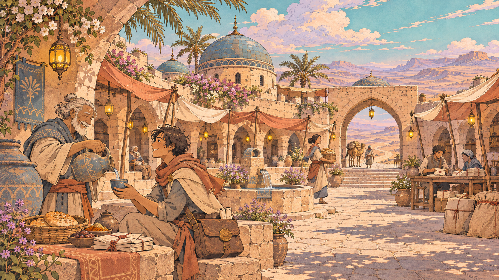
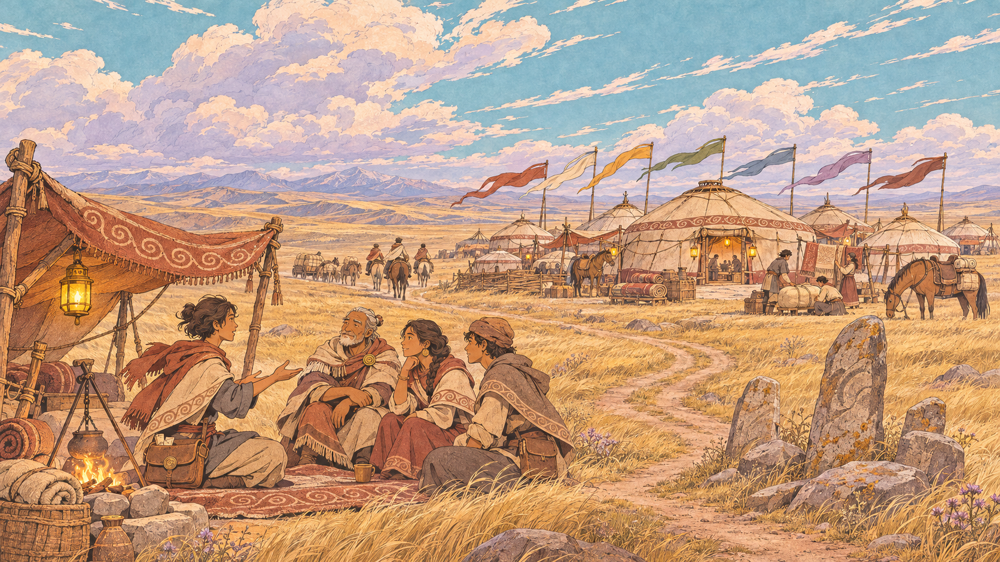
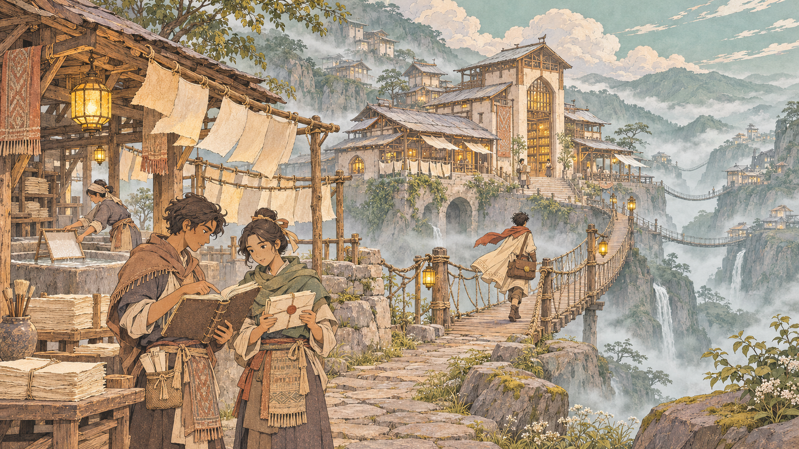
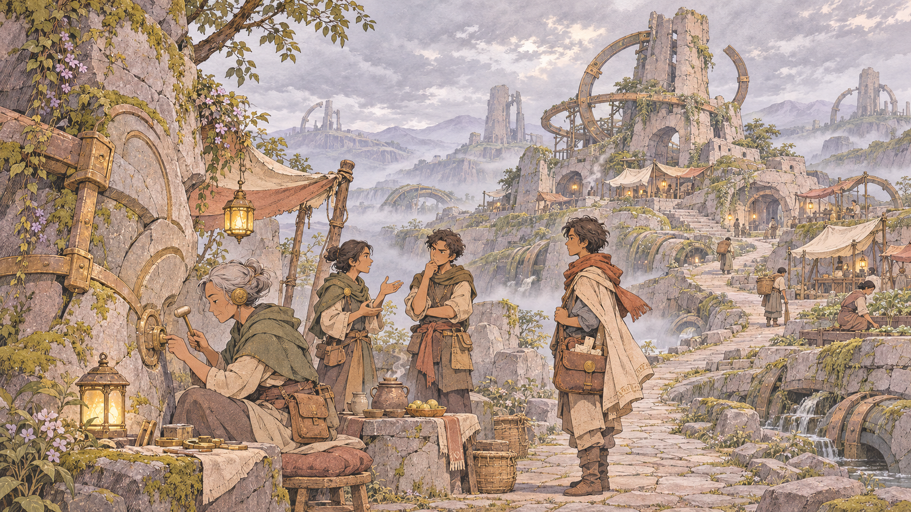
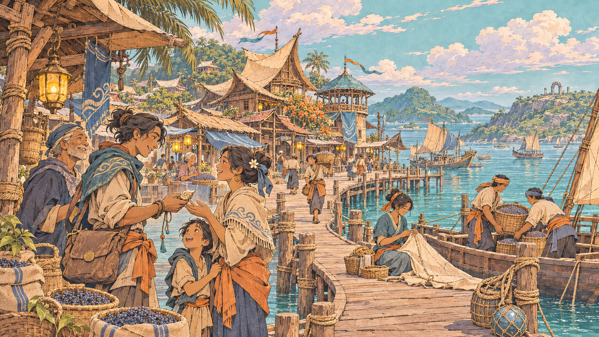

# Jalur Senyap

> “Supaya tidak ada orang yang menunggu sendirian.”


**Sebuah petualangan third-person tentang perjalanan, kabar, dan orang-orang yang menunggu.** Jadilah kurir muda di Tanah Lintas: baca medan, jaga titipan, dan temukan kisah di setiap persinggahan.

**[Mainkan demo](https://dhanesya98.github.io/jalursenyap/)** · **[Jelajahi Atlas Tanah Lintas](https://dhanesya98.github.io/jalursenyap/atlas.html)**

Demo untuk browser desktop dengan **keyboard, mouse, dan WebGL**. Dapat juga dimainkan secara lokal tanpa koneksi internet.

## Satu surat yang belum sampai

Dahulu, seratus menara bernama **Simpul** mengalirkan **Gema**: bunyi dan ingatan yang menempuh jarak jauh melalui batu resonansi. Lima bangsa bertukar kabar dalam sekejap. Namun Gema meneruskan apa yang diucapkan tanpa mengetahui apakah sebuah pesan benar atau bohong.

Lalu datang **Hari Senyap**. Seratus Simpul padam serentak. Kabar terputus, keluarga terpisah, dan setiap bangsa mewariskan penjelasannya sendiri tentang apa yang terjadi. Jalur Gema menjadi **Jalur Senyap**.

Cerita berlangsung pada **tahun ke-100 Telan**. Kamu adalah **Nara**, kurir magang berusia tujuh belas tahun dari **Dusun Sela**, yang tumbuh bersama Nenek Ima. Ayahnya, **Tarun**, berlayar lima tahun lalu, dan kabarnya terputus. Nara tahu bagaimana rasanya menunggu di gerbang untuk satu kabar kecil. Itulah alasan ia memilih menjadi kurir.

Di **Pos Batu Biru**, pengantaran roti dan lagu mempertemukan Nara dengan kehidupan orang-orang di sepanjang jalur. Saat badai datang, **Maren** menyerahkan **Surat Penyalaan**: titipan Sahdan dari Simpul Pertama, yang telah dijaga empat generasi. Tas tua Sahdan melindungi surat itu; segelnya hanya terbuka penuh setelah mendapat **Cap Saksi dari tiga bangsa**.

Bersama **Ruru**, pendamping kecil yang peka pada jejak Gema, Nara memulai perjalanan untuk mencari tahu mengapa dunia dibungkam—dan siapa yang layak dipercaya ketika suara-suara lama kembali terdengar.

## Perjalanan adalah gameplay

Tidak ada pertarungan, crafting, atau grinding. Tantangannya datang dari medan, cuaca, keputusan di jalan, dan tanggung jawab atas titipan yang kamu bawa.

1. **Baca medan.** Kenali pijakan batu, pasir lunak, ngarai, dan tebing curam. Amati landmark atau minta Ruru memindai jalur di sekitar.
2. **Rencanakan perjalanan.** Buka **Buku Jalur**, lihat tujuan dan pilihan rute, lalu pilih bekal alat di Pos Batu Biru.
3. **Temukan jalanmu.** Berlari, melompat, membuka **Jubah Layar** untuk melayang singkat, menarik diri dengan **Kait Tali**, atau memasang **Tangga Tali**.
4. **Jaga pesan.** Roti bisa dingin dan kerang bisa retak. Pengantaran tetap dapat diselesaikan; kondisi paket memengaruhi percakapan dengan penerima.
5. **Tinggalkan sesuatu bagi jalur.** Tangga yang dipasang tetap tersimpan. Pilihan dan pengantaran membangun **Nama Baik**, membuka kabar tambahan, serta mengisi catatan perjalanan.

### Cuaca mengubah perjalanan

| Kondisi | Yang kamu hadapi |
| --- | --- |
| **Cerah** | Cahaya hangat dan kesempatan mengenal jalan sebelum cuaca memburuk. |
| **Berkabut** | Cakrawala memendek. Landmark, peta, dan bantuan Ruru menjadi lebih berarti. |
| **Badai** | Jalur tol tertutup, pasir memperlambat langkah, dan Jubah Layar lebih cepat kehilangan daya angkat. Paket berisiko rusak di tempat terbuka. |

Menuju Simpul Sembilan, pilih **Jalur Lentera** yang lebih panjang dan terlindung, atau **Tebing Utara** yang lebih cepat tetapi terbuka terhadap angin.

## Lima bangsa, lima cara menjaga kabar

Tanah Lintas terhubung oleh persinggahan, karavan, arsip, dan jalur laut. Tiap bangsa punya adat, kepentingan, serta ingatan sejarah yang berbeda. Tidak semua orang dalam satu bangsa sepakat tentang masa lalu.

*Gambar berikut adalah ilustrasi konsep lingkungan dan kehidupan bangsa. Dunia yang dimainkan menggunakan model 3D; ilustrasi ini bukan tangkapan layar gameplay.*

### Asharim · Penjaga persinggahan



**Lembah Pasir** — Pos Batu Biru, Telaga Sumi, dan Dusun Sela. Air disediakan bagi pengembara dan pos menjadi tempat kabar bertemu wajah. **Hukum Air** menyatakan bahwa tak seorang pun boleh ditolak air.

> “Teduh di jalanmu.” — “Air di langkahmu.”

### Cirusia · Penjaga janji



**Padang Salkara** — Perkemahan Tujuh Panji dan Tepi Salkara. Para pengawal karavan menjaga janji lisan di hadapan saksi. Di antara panji yang berkibar, dendam lama dan keinginan berdamai sama-sama mencari tempat.

> “Angin searah.” — “Janji sampai.”

### Tseren · Penjaga catatan



**Pegunungan Kabut Lirih** — Desa Kertas Awan dan Gudang Naskah. Kertas, tinta, dan tenunan menghidupi masyarakat yang percaya bahwa kata harus dijaga. Sebuah tanggal yang keliru bisa membuat seluruh catatan layak dipertanyakan.

> “Tinta tenang.” — “Kata terjaga.”

### Lulanai · Penyetel yang tersisa



**Reruntuhan Hening** — Menara relay lama dan Simpul Pertama. Para penyetel dan keturunannya menjaga jejak yang tidak selalu utuh. Kaum Pantang, Terbuka, dan Sesal berbeda pendapat tentang apa yang seharusnya dilakukan terhadap Gema.

> “Hening menyertai.” — Dijawab dengan anggukan.

### Bahtari · Penjaga laut dan lagu



**Kepulauan Lada Biru** — Bandar Lada dan Simpul Keseratus. Pelaut membawa rempah, lagu, dan janji untuk pulang. Keluarga menitipkan suara pada kerang; biaya kabar dan izin sandar membuat jarak terasa semakin jauh.

> “Pasang baik!” — “Layar penuh!”

Kelima bangsa dapat dikenali lewat **Atlas** dan tab **Lima Bangsa** di Buku Jalur. Wilayah yang bisa dijelajahi dalam demo saat ini adalah **Lembah Pasir, milik Asharim**.

## Yang bisa dimainkan sekarang

Demo mencakup **Babak 1: Menyalakan kembali**, dengan tiga pengantaran:

| Pengantaran | Perjalanan |
| --- | --- |
| **Roti Rempah untuk Menara Batu Senja** | Belajar membaca jalan dan membawa roti hangat kepada Juma. |
| **Lagu untuk Telaga Sumi** | Menyeberangi ngarai untuk mengantar jejak lagu Dorin kepada Bu Lamat. |
| **Surat Penyalaan dari Simpul Pertama** | Membawa surat Maren yang masih bersegel menuju Simpul Sembilan di tengah badai. |

Tersedia percakapan bercabang, rumor dan penemuan, reputasi, pemilihan alat, peta, checkpoint, serta penyimpanan lokal. Musik, efek suara, dan lagu Kerang Suara aktif; **VO percakapan dinonaktifkan**.

Perjalanan lintas lima wilayah dan tiga pilihan akhir merupakan arah cerita penuh. **Empat wilayah di luar Lembah Pasir, pilihan akhir, Malam Tenang, bivak, multiplayer, dan pilihan gender Nara belum dapat dimainkan.** Target durasi demo 15–20 menit masih perlu divalidasi lewat playtest.

<details>
<summary><strong>Kontrol keyboard dan mouse</strong></summary>

| Tombol | Aksi |
| --- | --- |
| WASD / panah | Bergerak |
| Shift | Berlari |
| Spasi | Lompat; tahan saat turun untuk membuka Jubah Layar |
| Mouse | Mengatur kamera; klik dunia untuk mengunci pointer |
| E | Bicara, memeriksa, memanjat tangga atau tepian bertanda |
| F | Menarik diri menuju cincin Kait Tali dalam pandangan |
| L | Memasang Tangga Tali di penanda |
| Q | Meminta Ruru memindai medan; jeda 12 detik |
| J | Membuka Buku Jalur |
| H | Panduan kontrol |
| Esc | Melepas pointer atau membuka jeda / menutup menu |

Kait Tali dan Tangga Tali terbuka pada tugas kedua. Bekal dapat diubah di Pos Batu Biru. Jatuh ke jurang mengembalikan Nara ke pos terakhir; paket yang tergores tetap bisa diantar.

</details>

## Mainkan secara lokal

1. Unduh repositori melalui **Code → Download ZIP**, lalu ekstrak seluruh isinya.
2. Buka **`index.html`** di browser desktop dengan WebGL. Di Windows, **`Mainkan.bat`** membuka halaman yang sama.
3. Klik **Mulai perjalanan**, temui Maren, lalu ikuti petunjuk di Buku Jalur.

Semua aset tersedia lokal. Jika browser membatasi penyimpanan dari berkas lokal, jalankan server dengan Node.js:

```sh
npm run dev
```

Lalu buka **http://127.0.0.1:4173**. Untuk membangun ulang data dan menjalankan pemeriksaan:

```sh
npm run build
npm test
```

## Arah visual dan inspirasi

Garis tinta sepia, bidang warna gouache, tekstur kertas, dan cahaya kuning lentera mengikat kelima bangsa dalam satu dunia. Ilustrasi 2D dibuat dengan ImageGen; karakter dan lingkungan yang dimainkan dibangun sebagai model 3D prosedural.

Jalur dagangnya mengambil inspirasi dari **prinsip Jalur Sutra**: pertukaran, persinggahan, dan kepercayaan. Bangsa, sejarah, serta tokohnya adalah fiksi. **Death Stranding** menginspirasi keputusan dalam perjalanan, **Outer Wilds** rasa ingin tahu, serta **Moebius** dan **Studio Ghibli** bahasa visual dan kehangatan keseharian.

<details>
<summary><strong>Dokumentasi dan sumber aset — sebagian memuat spoiler cerita</strong></summary>

- [Story Bible Gabungan](docs/STORY-BIBLE.md): acuan kanon terbaru, sejarah, tokoh, dan kelanjutan cerita.
- [Catatan implementasi](docs/IMPLEMENTASI.md): fitur yang tersedia dan batas demo.
- [Brief desain historis](docs/BRIEF.md): jejak rancangan awal; kanon terbaru mengikuti Story Bible.
- [Atlas Tanah Lintas](https://dhanesya98.github.io/jalursenyap/atlas.html): ilustrasi, peta, ikon, dan model 3D yang dapat diputar.
- [Kredit aset](assets/CREDITS.md) dan [prompt ilustrasi lima bangsa](assets/world/nations/prompts-dan-sumber.json).

</details>
