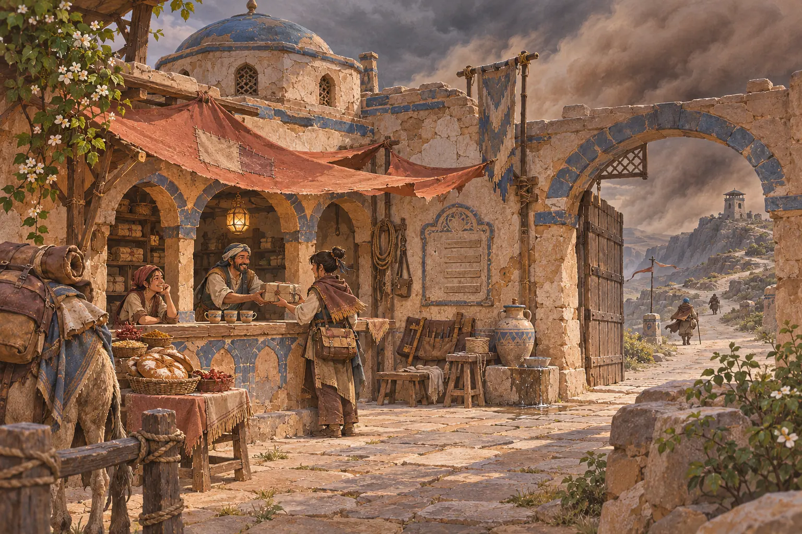

# The Silent Route



*Ilustrasi konsep Lembah Pasir di Tanah Sada.*

**The Silent Route** adalah game petualangan *third-person* 3D tentang seorang kurir muda yang mengantar surat, janji, lagu, dan paket antarbangsa di dunia fantasi **Tanah Sada**. Tanpa combat, tanpa crafting, tanpa grinding. Yang ada hanyalah perjalanan, membaca kontur medan dan cuaca, serta kehangatan cerita di setiap pengantaran.

---

## 🎮 Coba Mainkan

Jalankan `npm run dev` dan buka alamat lokal yang ditampilkan. Game memakai Three.js lokal dengan **kamera perspektif 3D** (`52° FOV`), model **Nara GLB v2** dengan sayap **Jubah Layar**, garis tinta, arsiran bayangan, dan lingkungan batu pasir yang telah diperluas skalanya.

Bab 0 dan Bab 1 memiliki **38 langkah quest**. Area yang dapat dimainkan mencakup Pos Nilasar, Menara Senja di bukit pengamat barat laut, Telaga Sumi dan Balai Cawan, kompleks Menara Simpul 009 & Bangunan Uji, Dusun Sela di lereng timur, serta perkemahan Tujuh Panji di Padang Salkara utara. Bab 1 berakhir dengan janji membawa bukti; Cap Cirusia belum diberikan. Bab 2 dan seterusnya belum menjadi bagian dari slice ini.

Kontrol yang digunakan: WASD/panah, Shift, Spasi, mouse, E, F (Pasak Pijak), Q (Ruru Pindai), G (Direktori Kompas & Tantangan), Tab/J, M, serta Esc. Gulir mouse mengubah jarak pandang kamera 3D. Data dan aset tersedia lokal; tidak ada publikasi atau layanan daring yang diperlukan.

Rincian susunan node dan validasi ada di [catatan redesain](docs/REDESAIN-BAB0-1.md).

---

## 📜 Premis Cerita (Tahun ke-100 Telan · Kanon Revisi 9 November 2026)

Acuan: `docs/STORY-BIBLE.md`, identik dengan `STORY bible/jalur_senyap_story_bible_rev9nov.md` dan paket The Silent Route Update. Sinkronisasi teks implementasi diperiksa 12 November 2026; tanggal ini bukan revisi kanon baru.

Dahulu, seratus menara penghubung bernama **Menara Simpul** mengalirkan **Echoes** — fenomena gaung langka pada **Batu Gaung** yang menyimpan dan meneruskan getaran suara, ingatan, serta kabar antarbangsa di **Tanah Sada**. Titik asal Echoes bermula dari tambang basalt Lulan Tua (~410 Pra-Telan) di mana tiga orang gugur (Yazhir dan dua penggali) karena para pendiri sengaja diam menutupi kejadian; tambang dikubur rapat di bawah **Menara Simpul Pusat** (400 Pra-Telan) dan cerita resmi penemuan disusun. Jaringan dibangun oleh Lulanai bersama bangsa-bangsa setempat pada 400–250 Pra-Telan, dengan pelapisan Urat Sumi Asharim secara cuma-cuma sebagai penebus rahasia. **Ikrar Sambung** baru disepakati pada 120 Pra-Telan: kemitraan Lulanai (teknik dan kunci) dengan Dewan Tetua (jalur, iuran, dan pos). Keputusan besar wajib diambil bersama; dalam bahaya, salah satu pihak wajib memberi tahu pihak lain.

Namun Echoes tidak pernah menguji kebenaran pesan. Kabar dusta dan perang propaganda memecah bangsa-bangsa hingga memicu **Kabar Tujuh Musim** dan gelombang **gaung liar** yang mengancam menghancurkan akal manusia. Pada **Tahun 0 (Tahun Telan / Hari Senyap / Malam Tiga Napas)**, para arsitek Lulanai mengambil keputusan sepihak tanpa memberi tahu Dewan Tetua, melanggar **Ikrar Sambung**: mereka memutus jaringan Menara Simpul secara serentak dengan menelan gelombang kejut ke tubuh mereka sendiri. Sisa gelombang dialirkan lewat Garis Surut ke Gerbang Surut di **Menara Simpul Keseratus** dan ditahan di balik **Bejana Batu**. Kurir legendaris **Sahdan** menjadi jangkar penstabil di **Menara Simpul Pusat** (001) dan wafat sebagai manusia pada Malam Tiga Napas. **Perkara Pemutusan** kemudian menjadi tuduhan hukum; **Bising menular** dan **Penelan Suara** adalah stigma dan takhayul terhadap penyintas, bukan fakta bahwa Lulanai menyebarkan penyakit atau menelan suara orang lain.

Seratus tahun telah berlalu (**Tahun ke-100 Telan**). Peradaban belajar hidup dalam keheningan, bertumpu pada kaki para kurir independen di Pos Singgah. Di sisi lain, **Dewan Tetua** memonopoli jalur dengan *Ajaran Tata* (*"Tata mengelola." / "Yang tua menjaga jalan."*) dan menjual kabar tersaring lewat tujuh **Menara Simpul Redup**. Tanpa disadari dunia, Bejana Batu seratus tahun itu kini mulai melemah dan tanda tekanan muncul di berbagai penjuru.

Kamu adalah **Nara** (17 tahun), putri mendiang **Nadiyah** dan **Tarun**, kurir magang asal **Dusun Sela** yang melangkah agar *tidak ada lagi orang yang menunggu kabar sendirian*. Dalam **Bab 0 — Pos Nilasar (Batu Biru)**, **Marsiyah** meminjamkan tas kulit berlapis peredam peninggalan Sahdan sebelum tugas pertama. Setelah roti hangat untuk **Jumel**, **Lagu Titipan** untuk **Bu Lamit** dari **Tiwano**, dan laporan jujur atas tugas ketiga yang tertahan **Kesa** (prajurit tetua di Gerbang Dewan Tetua) ditambah lengkapnya tanda bahaya cincin uji **009**, Marsiyah menyerahkan **Surat Penyalaan** — titipan rahasia empat generasi (*Saryel → Azhel → Ilyam → Marsiyah*) dengan seratus tanda arsitek. Marsiyah membubuhkan **Cap Saksi Asharim** di atas bantalan tinta gaung yang merekam suara nama Marsiyah dan nama Nara. Segel teks surat terbuka setelah serah-terima sah dengan cap **Asharim, Cirusia, dan Tseren**. Lulanai sebagai perancang dan Bahtari sebagai tuan rumah gerbang tidak memberi cap. Terbukanya teks belum berarti kode teknik dipahami atau gaung boleh langsung dilepas.

Di **Pembuka Bab 1 — Dusun Sela**, Nara dan **Ruru** tiba di kampung halaman tepat ketika kabar **Sidang Tujuh Panji** memanas. **Nenek Ima** mengeluarkan **Penutup Telinga Perunggu** warisan masa Perkara Pemutusan dari kotak kayu di bawah tempat tidurnya dan menjelaskan ketakutan keluarga terhadap tuduhan Bising menular, sementara **Orsuk** dari **Panji Balkut** mengajak Nara menembus **Padang Salkara** untuk membawa kesaksian netral.

---

## 🧭 Inspirasi & Kompendium Lima Bangsa

Dunia **Tanah Sada** terinspirasi dari prinsip jalur dagang kuno (*Silk Road*) dan sistem pos estafet (*caravanserai*):

- **Kepercayaan sebagai mata uang & Ikrar Sambung:** Reputasi per bangsa (**Nama Baik**) menentukan akses ke pos, pengawalan karavan, dan izin melintas. Cap Saksi mencatat mandat serah-terima dan terpisah dari Nama Baik; cap bukan bukti kebenaran pesan. Perdagangan memakai (**Keping Tata**, **Garam Batu Batangan**, dan **Lada Biru**).
- **Barang membawa jiwa:** Yang dibawa kurir bukan sekadar muatan fisik, melainkan roti hangat tanda rindu, **Lagu Titipan** dalam Kerang Suara berisi rekaman lagu keluarga, hingga janji lisan antarpanji.
- **Toolkit Ekspedisi Kurir & Malam Tiga Cawan:** Mengandalkan **Pasak Pijak**, **Tangga Tali**, **Jembatan Papan**, dan **Jubah Layar** untuk menaklukkan medan, serta beristirahat di Pos Singgah dalam tradisi **Malam Tiga Cawan** (*Cawan Air, Cawan Garam, Cawan Kabar*).
- **Lima Bangsa di Tanah Sada:**
  1. **Asharim (Lembah Pasir):** Penjaga persinggahan dan penguasa mata air gurun di bawah *Pakta Sumur Terbuka (Hukum Air)*. Semboyan: *"Air tidak bertanya nama."* Terbelah antara Kubu Pos Tua (adat suaka netral) dan Kubu Pos Dagang (rekanan Dewan Tetua).
  2. **Tseren (Pegunungan Silin (Kabut Lirih)):** Penjaga catatan, pembuat kertas serat tahan air, dan notaris hukum di bawah *Kanon Aksara*. Semboyan: *"Tinta tak pernah lupa."* Terbelah antara Aliran Murni (seperti Wuren) dan Aliran Selaras (dipimpin Lisen).
  3. **Cirusia (Padang Salkara):** Penjaga janji dan pengawal karavan sabana di bawah *Sumpah Api Tujuh Panji*. Semboyan: *"Bohonglah di depan api, kalau berani."* Dipimpin sidang 7 klan (**Panji Gorkan, Dolgak, Sarbuk, Balkut, Tumran, Ulmar, Kadum**) dalam kebuntuan politik 3–3–1.
  4. **Bahtari (Kepulauan Lamuna):** Penjaga laut dan lagu di bawah *Hukum Sauh & Lagu*. Memonopoli lada biru (pengawet pangan utama). Semboyan: *"Pasang selalu kembali."* Terbelah antara oligarki Rumah Dagang (dipimpin Wanuri) dan serikat Rumah Layar (Tiwano, Tarun).
  5. **Lulanai (Lulan Tua):** Bangsa arsitek pembangun negara dan perancang jaringan Menara Simpul di bawah *Ikatan Arsitek*. Semboyan: *"Dengar dan resapi."* Terpencar dalam tiga faksi: Kaum Pantang (dipimpin Mairuma), Kaum Terbuka (dipimpin Ruania), dan Kaum Sesal (dipimpin Lunaia).

---

## 🕹️ Kontrol Permainan

| Tombol | Aksi |
| --- | --- |
| **W, A, S, D** / Panah | Berjalan / Berlari |
| **Shift** | Lari cepat (*Sprint*) & meluncur di turunan pasir (*Sand-sliding*) |
| **Spasi** | Melompat; tahan saat jatuh untuk membuka **Jubah Layar** (*Glide*) |
| **Mouse** | Mengarahkan kamera 3D; klik layar untuk mengunci kursor, gulir untuk zoom |
| **E** | Interaksi kontekstual: bicara dengan NPC, periksa pos/altar, panjat & pasang Tangga Tali |
| **F** / Klik Kanan | Menambatkan **Pasak Pijak** pada cincin penanda tebing |
| **Q** | Pindai kontur medan, sub-zona, dan arah tujuan bersama Ruru (*cooldown* 12 detik) |
| **G** | Membuka **Direktori Kompas & Tantangan** (Panduan arah sub-zona, Tantangan A/B/C, & Mini-Games) |
| **Tab** / **J** | Membuka **Buku Jalur** (Kompendium in-game: Tugas/Quests, Cerita/Lore, Lima Bangsa, Perlengkapan/Gear) |
| **M** | Membuka **Peta Wilayah** (Kartografi ekspedisi Lembah Pasir & Dusun Sela, elevasi kontur & rute) |
| **H** / **Esc** | Panduan bantuan / Menu jeda (*Pause*) |

### Tips Perjalanan:
- Permukaan batu memberi cengkeraman lebih cepat daripada pasir lembut, namun turunan pasir curam memberikan dorongan *sand-sliding* saat berlari.
- Badai pasir gurun menguras daya apung Jubah Layar lebih cepat dan mengikis paket yang tidak terlindung.
- Musik latar (BGM) mengalun dinamis dan meredam menjadi *ambience* syahdu saat berbicara dengan NPC.

---

## 📖 Atlas & Buku Jurnal

- **Atlas Tanah Sada (`atlas.html`):** Katalog visual interaktif yang memuat model 3D karakter (termasuk **Nara GLB v2**, **Nenek Ima**, **Orsuk**, dan ketujuh pemimpin Panji Cirusia) serta 17 properti dengan pemeriksa sudut putar, galeri 34 portrait dialog (`PORTRAIT.html`), peta wilayah beresolusi tinggi, serta kompendium lengkap Lima Bangsa.
- **Buku Jalur (tekan `Tab` atau `J` dalam game):** Jurnal lapangan kurir yang menyajikan peta elevasi kontur riil, status pengantaran, rumor & penemuan, Nama Baik dan mandat Cap Saksi, serta kompendium bangsa.

---

## 🛠️ Pengembangan & Pengujian Lokal

Proyek ini dibangun menggunakan JavaScript murni (vanilla), Three.js lokal, HTML5/CSS3, dan Node.js untuk script build:

```sh
# Rebuild bundle data offline, link dialog, dan peta SVG
node tools/build.cjs

# Menguji questline, simpanan, kanon, dan keterjangkauan semua tujuan
npm test

# Menjalankan server lokal (opsional)
node tools/serve.cjs
# Buka http://127.0.0.1:4173
```

---

## 📁 Berkas Dokumentasi & Kanon

- [`docs/GAME-DESIGN-ART-DIRECTION.md`](docs/GAME-DESIGN-ART-DIRECTION.md): **Game Design & Art Direction (Revisi Kanon 9 November 2026)** — panduan lengkap arsitektur mekanik, Toolkit Ekspedisi Kurir, Malam Tiga Cawan, dan arahan seni.
- [`docs/STORY-BIBLE.md`](docs/STORY-BIBLE.md): **Story Bible (Revisi Terpadu 9 November 2026)** — dokumen acuan kanon lengkap 100 tahun Tanah Sada, Kunci Lore, Kompendium Lima Bangsa, Bab 0–5, dan percabangan tiga akhir cerita.
- [`docs/BAB0-QUESTLINE.md`](docs/BAB0-QUESTLINE.md): Spesifikasi alur Questline Bab 0.
- `pos-batu-biru.html`: Halaman studi visual Pos Nilasar (Batu Biru).
