# Jalur Senyap (*The Silent Route*)

> **Buku I (Bab 0–1) · Versi 6.0.0 · 2D Pixel Top-Down · Era Tahun ke-103 Post-Senyap**

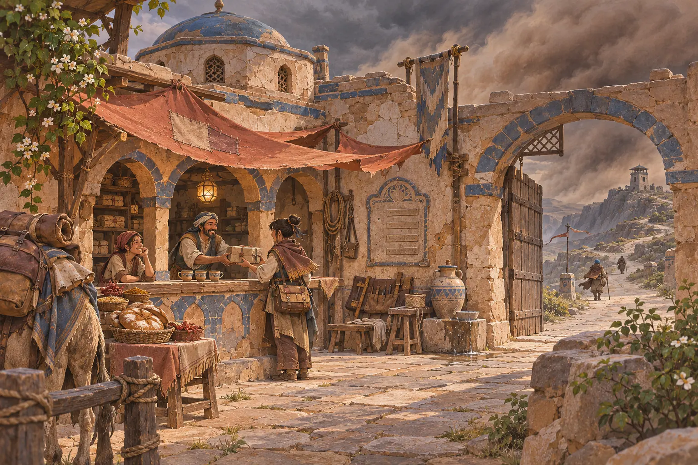

*Ilustrasi konsep Lembah Pasir di Tanah Sada — Nara dan Ruru memandang jalur panjang menuju cakrawala.*

**Jalur Senyap (*The Silent Route*)** adalah game petualangan *2D pixel top-down* berlatar *grounded low-fantasy* tentang **Nara**, seorang **perintis kafilah (*pathfinder*)** muda di benua **Tanah Sada**. Tanpa *combat*, tanpa *crafting*, dan tanpa *grinding*—inti permainannya adalah membaca kontur medan dan cuaca, membuka jalur ekstrem bagi rombongan karavan, memecahkan teka-teki *Echoes*, serta merangkai kebenaran di balik sejarah yang terbelah.

---

## 🎮 Coba Mainkan

- **Langsung di Browser (GitHub Pages / Lokal):** Buka [`index.html`](index.html) melalui server lokal (`npm run dev`, lalu kunjungi `http://127.0.0.1:4173`).
- **Paket Offline Tunggal:** Jalankan `npm run build` untuk menghasilkan berkas mandiri `Bab0-TopDown-Pixel/Jalur-Senyap-Complete-Pixel.html` (seluruh skrip, gaya, potret, dan audio sudah tertanam).

### Status Slice Saat Ini (Buku I — Bab 0 & Bab 1)
- **Cakupan:** **8 peta**, **22 sekuens cerita**, dan **58 objektif** (*Pos Nilasar*, *Telaga Sumi*, *Balai Cawan*, *Menara Senja*, kompleks *Menara Simpul ke-9 & Bangunan Uji*, *Dusun Sela*, jalur *Sabuk Remuz–Zamer*, serta *Perkemahan Tujuh Panji* di Padang Salkara).
- **Bab 2–5** (*Tepi Salkara & Arsip Tseren*, *Bandar Lada*, *Lulan Tua & Benteng Tata*, hingga *Menara Simpul ke-99 / Gerbang Surut*) tercatat lengkap di *Story Bible* sebagai kelanjutan pengembangan berikutnya.

---

## 📜 Premis & Sejarah Dunia (*Kanon Tahun ke-103 Post-Senyap*)

> *"Seratus tiga tahun setelah **Hari Senyap** membungkam seluruh benua, seorang perintis kafilah muda bernama **Nara** menerima sebuah **Cincin Perunggu** kuno yang diam-diam menyetrum jarinya—membawanya ke tengah perebutan kekuasaan antara Dewan Tetua yang memonopoli jalur, serbuan klan berkuda utara yang kelaparan, dan seorang penyintas Lulanai bernama **Maruani** yang ingin menundukkan kelima bangsa di bawah kekuatan getaran purba."*

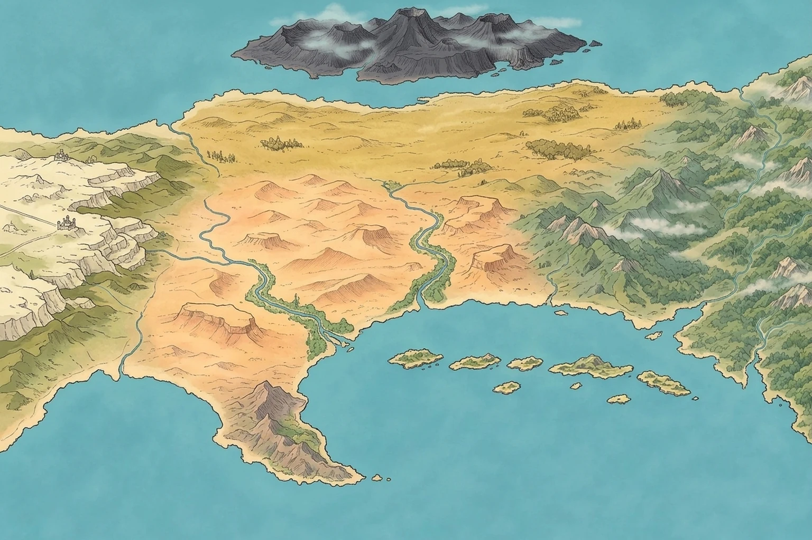

### Latar Sejarah Singkat
- **Asal Mula *Echoes* (~512–243 Pra-Senyap):** Di kaldera vulkanik **Lulan Tua**, bangsa **Lulanai** menemukan sifat akustik **Batu Gaung** dan menciptakan metalurgi **Perunggu Gaung (*Sada-Bronze*)**. Mereka menukar pembangunan infrastruktur dan **99 Menara Simpul** dengan pasokan pangan dari empat bangsa lain, namun menyembunyikan cacat fatalnya: **Beban Gaung**, yang bila jenuh memicu **Echoes Liar** dan merusak saraf pendengaran (**Bising**).
- **Ikrar Sambung (124 Pra-Senyap) & Perang Tujuh Musim (4 Pra-Senyap):** Kelima bangsa membentuk **Dewan Tetua** di **Benteng Tata**. Konflik dagang dan distorsi kabar di pesisir Tepi Salkara memicu *Perang Tujuh Musim* (~3,5 tahun; 1 tahun = 2 musim: *Musim Terang* & *Musim Dingin*).
- **Hari Senyap / Malam Tiga Napas (Tahun 0):** Untuk menghentikan gelombang *Echoes Liar*, **5 Arsitek Agung Lulanai** memutus serentak 99 Menara Simpul tanpa meminta izin Dewan Tetua, mengalirkan sisa gelombang lewat **Garis Surut** ke ruang bawah laut **Bejana Batu** di bawah **Gerbang Surut** (Menara Simpul ke-99). Sebelum gugur, **Wilanu** menempa **Cincin Perunggu**, dan perintis agung **Sahdan** membawanya ke Pos Nilasar lalu menjadi jangkar di Menara Simpul ke-1.
- **Tahun 58–103 Post-Senyap:** Dewan Tetua menuntut Lulanai lewat **Perkara Pemutusan**, menyebar stigma **Bising Menular** dan **Penelan Suara**, lalu menyalakan **7 Menara Simpul Redup** dengan teknik cacat. Akibatnya, Bejana Batu mulai retak (**Retak Besar** mengancam), sumur Cirusia membeku lebih awal, dan **Menara Simpul ke-9** memancarkan tiga denyut tanda bahaya.

---

## 🔮 Sistem *Low-Fantasy*: *Echoes*, Perunggu Gaung, & Cincin Perunggu

- **Perunggu Gaung (*Sada-Bronze*):** Paduan tembaga-timah-bubuk Batu Gaung yang ditempa dengan frekuensi suara (*Tempa Nada*). Satu-satunya logam yang mampu menahan, menyalurkan, atau meredam *Echoes*.
- **Nada Pengikat:** Teknik akustik arsitek Lulanai berpendengaran utuh—mampu membaca getaran langkah dari jauh, meretakkan batu rapuh, mengunci pintu basalt, hingga melumpuhkan keseimbangan lawan lewat dengung frekuensi rendah.
- **Cincin Perunggu (Kunci Nadi & Dua Separuh Kunci):**
  - Terkunci secara biologis pada **detak nadi keturunan Lulanai** yang pertama kali mengaktifkannya di menara (**Nara**). Jika direbut paksa, cincin kembali menjadi logam mati.
  - Hanya menyimpan **separuh kode** pembuka Gerbang Surut; separuh lainnya (**Nada Penyegel**) berada di inti **Menara Simpul ke-1** di Lulan Tua.

---

## 🧭 Lima Bangsa di Tanah Sada

| Asharim (Barat) | Cirusia (Utara) | Tseren (Timur) | Bahtari (Selatan) | Lulanai (Pusat) |
| :---: | :---: | :---: | :---: | :---: |
| 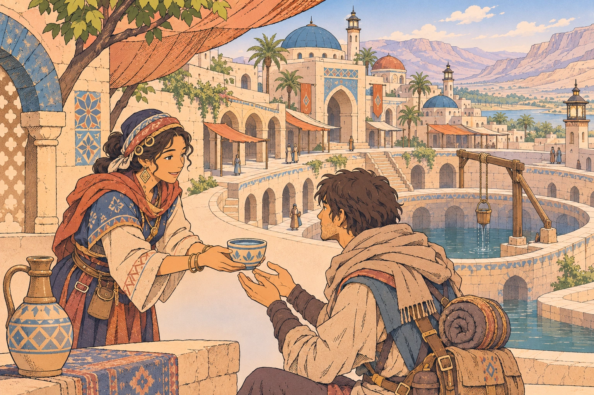 | 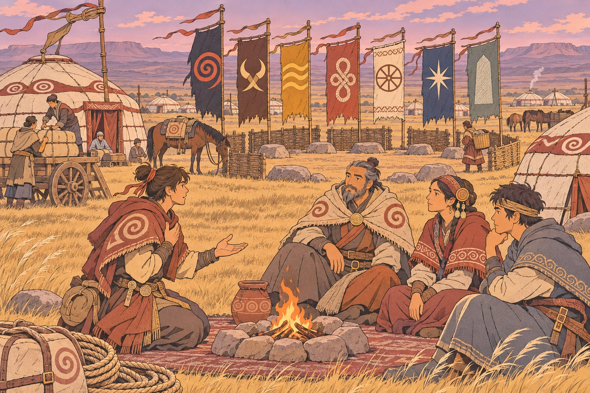 | 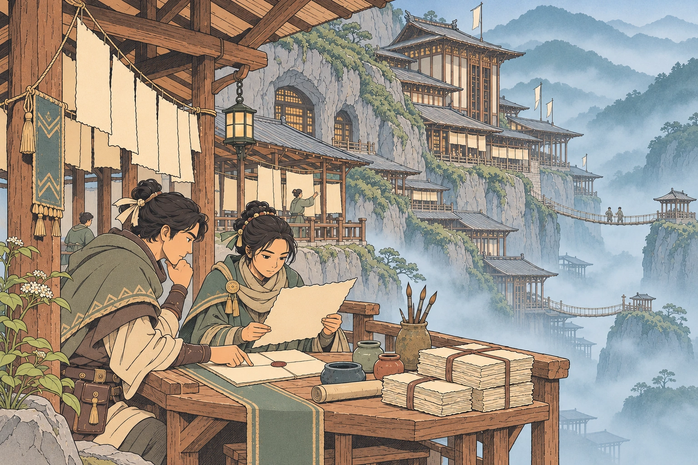 | 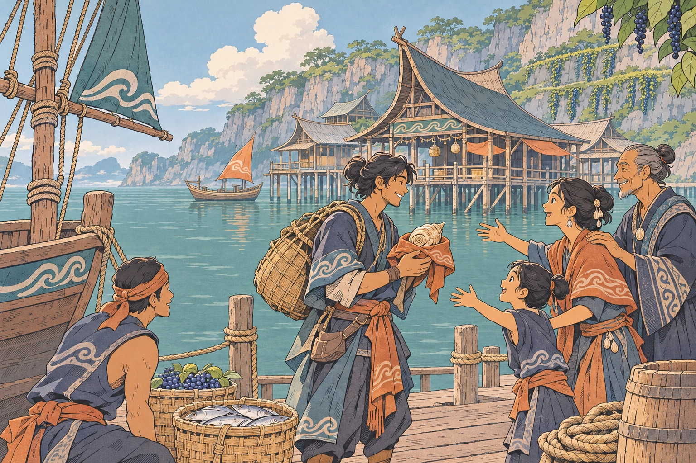 | 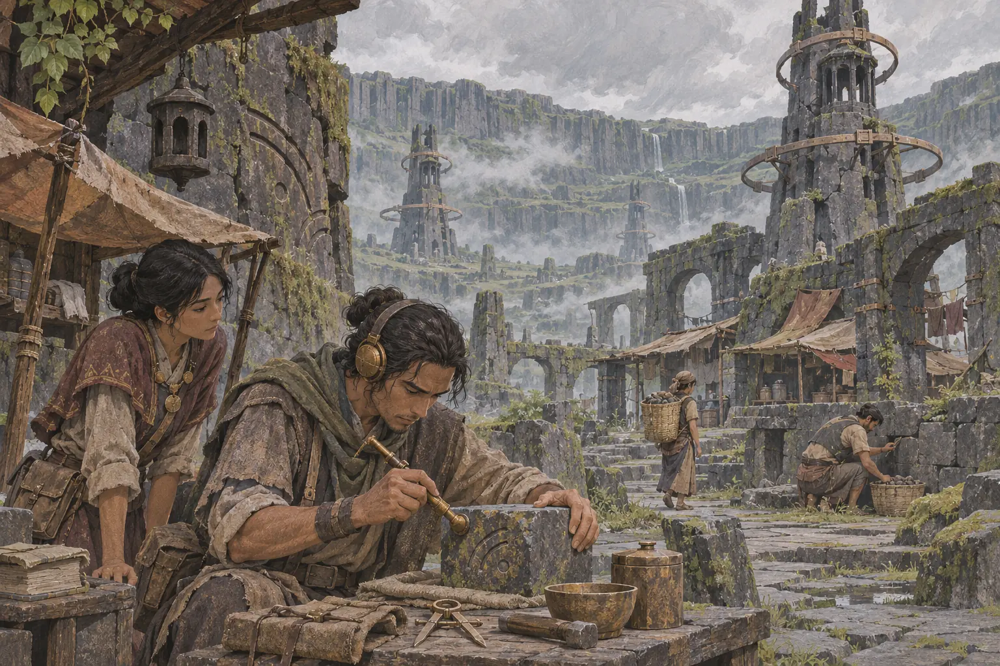 |
| **Suaka Air & Kafilah Gurun** | **Konfederasi Tujuh Panji** | **Birokrasi Arsip Tebing** | **Pelaut & Kartografer** | **Arsitek Perunggu Gaung** |
| *"Air tidak bertanya nama."* | *"Bohonglah di depan api, kalau berani."* | *"Tinta tak pernah lupa."* | *"Pasang selalu kembali."* | *"Dengar dan resapi."* |

1. **Asharim (Lembah Pasir & Sabuk Remuz–Zamer):** Penjaga mata air di bawah *Pakta Sumur Terbuka (Hukum Air)* dan tradisi **Malam Tiga Cawan** (*Air, Garam, Kabar*). Mengandalkan mata uang pasar bebas **Garam Batu Batangan**. Terbelah antara *Kubu Pos Tua* (netral) dan *Kubu Pos Dagang* (rekanan Dewan).
2. **Cirusia (Padang Salkara & Tepi Salkara):** Konfederasi berkuda di bawah *Hukum Janji Api* dan sidang **Tujuh Panji**—3 Panji Tua (**Gorkan, Dolgak, Sarbuk**), 3 Panji Muda (**Balkut, Tumran, Ulmar**), dan 1 Penengah (**Panji Kadum**). Terjepit krisis rumput dan blokade garam.
3. **Tseren (Pegunungan Silin / Kabut Lirih):** Pembuat kertas serat tahan lembap, tinta mineral, *Cakar Tebing*, dan *Jubah Layar* di bawah *Kanon Aksara*. Terbelah antara **Aliran Murni** (*Wuren*) dan **Aliran Selaras** (*Lisen*, yang menyunting arsip *Perkara Pemutusan*).
4. **Bahtari (Kepulauan Lamuna & Bandar Lada):** Pemasok *lada biru*, *garam laut*, dan *minyak ikan palung*, pencipta peta 3D *Bagan Arus*, serta penjaga adat *Lagu Titipan* dan *Kerang Suara*. Terbelah antara **Rumah Dagang** (penjerat *Kontrak Sauh* & *Utang Kabar*) dan **Rumah Layar**.
5. **Lulanai (Kaldera Lulan Tua):** Bangsa arsitek pembangun 99 Menara Simpul yang kini hidup bersembunyi pasca-Hari Senyap. Terpecah menjadi **Kaum Pantang** (*Mairuma*), **Kaum Terbuka** (*Ruania*), dan **Kaum Sesal** (*Lunaia*).
6. **Dewan Tetua (Benteng Tata):** Penguasa jalur dengan motto *Ajaran Tata* (*"Tata mengelola." / "Yang tua menjaga jalan."*) dan mata uang **Keping Tata** yang nilainya terus merosot.

---

## 👥 Tokoh Kunci

| Nara & Ruru | Marsiyah | Dunia & Landmark |
| :---: | :---: | :---: |
|   |  | 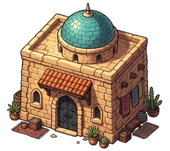 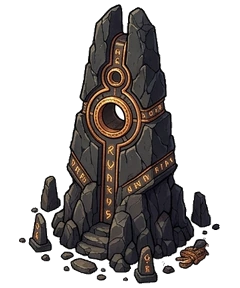 |

- **Nara (17 tahun) & Ruru:** Perintis kafilah muda asal Dusun Sela bersama satwa gurun bertelinga peka. Tanpa sadar mewarisi darah Lulanai dari ibunya (**Nadiyah**) dan bertekad mencari ayahnya (**Tarun**) yang tertahan di Bandar Lada sejak 97 Post-Senyap.
- **Marsiyah:** Kepala Pos Nilasar (*Batu Biru*) dan penjaga ke-4 Cincin Perunggu; menguji Nara dan mempercayakan cincin tersebut sebelum prajurit Dewan menyerbu pos.
- **Maruani (Antagonis Utama):** Arsitek diaspora Lulanai berpendengaran utuh yang membawa garpu tala Perunggu Gaung asli dan menguasai *Nada Pengikat*. Karena Cincin Perunggu terkunci pada nadi Nara, ia memanipulasi krisis antarbangsa untuk memaksa Nara bekerja sama.
- **Tokoh Penting Lainnya:** **Sahdan** (Perintis Agung, jangkar Menara Simpul ke-1), **Nenek Ima** (penyintas Lulanai di Dusun Sela, penjaga *Penutup Telinga Perunggu*), **Kesa** (komandan muda prajurit tetua yang mulai goyah), **Jumel** & **Bu Lamit** (penjaga Menara Senja & Telaga Sumi), **Orsuk** & **Odgar** (Panji Balkut & Panji Kadum), **Tiwano** & **Tarun** (pelaut Rumah Layar), **Wuren** & **Lisen** (arsiparis Tseren), serta **Taluk** (*Yang Tetua* di Benteng Tata).

---

## 🗺️ Galeri Lanskap Tanah Sada

| Pos Nilasar (Asharim) | Menara Simpul ke-9 | Padang Salkara (Cirusia) |
| :---: | :---: | :---: |
| 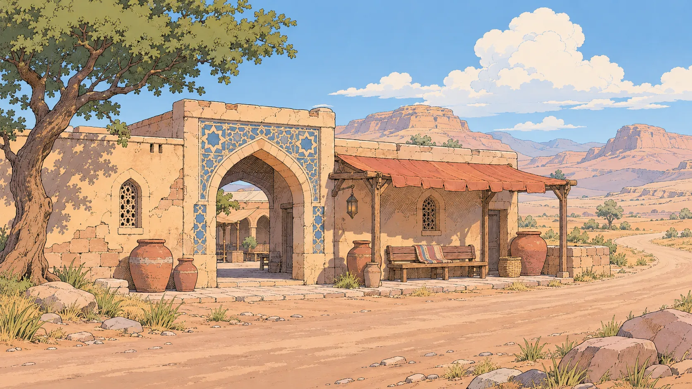 | 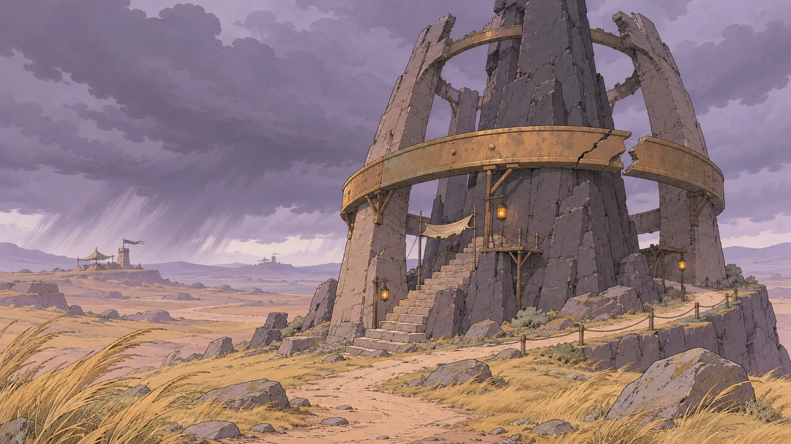 | 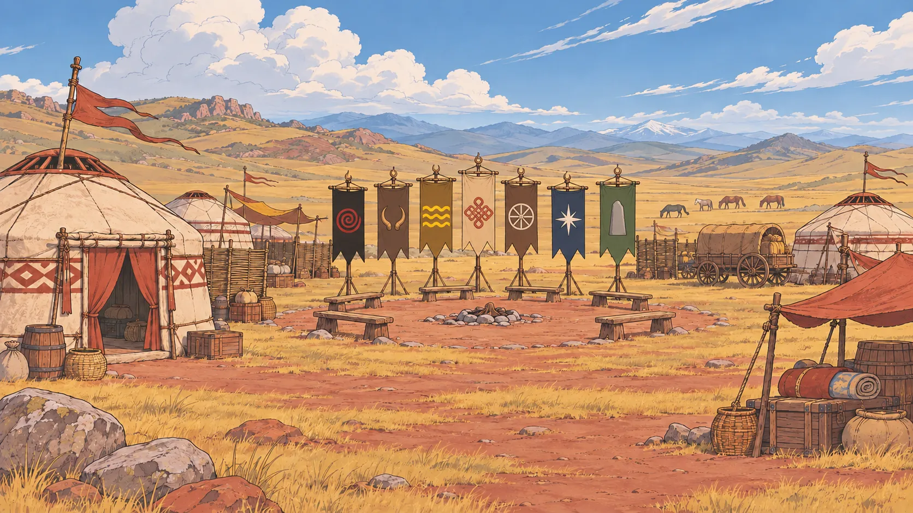 |
| **Pegunungan Silin (Tseren)** | **Bandar Lada (Bahtari)** | **Lulan Tua & Menara Pusat** |
| 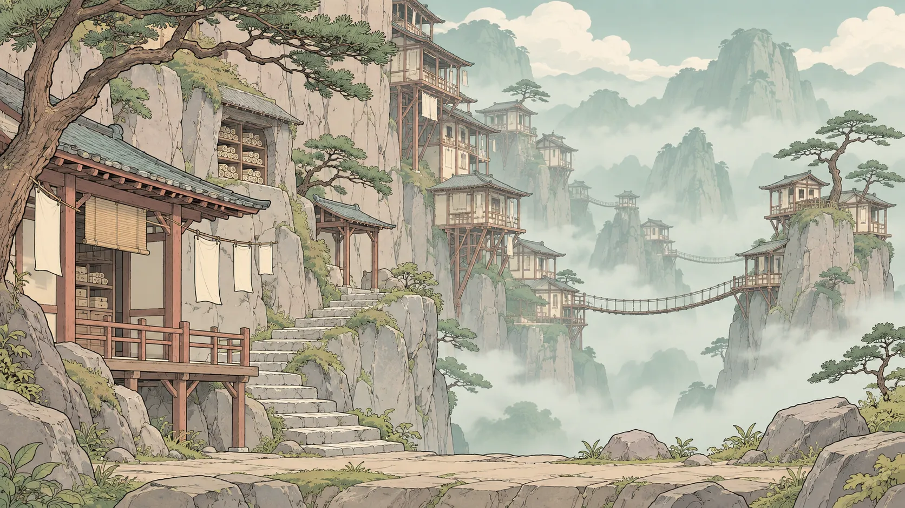 | 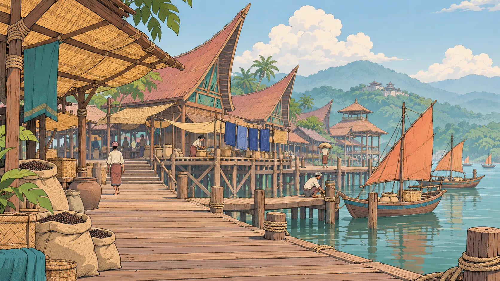 | 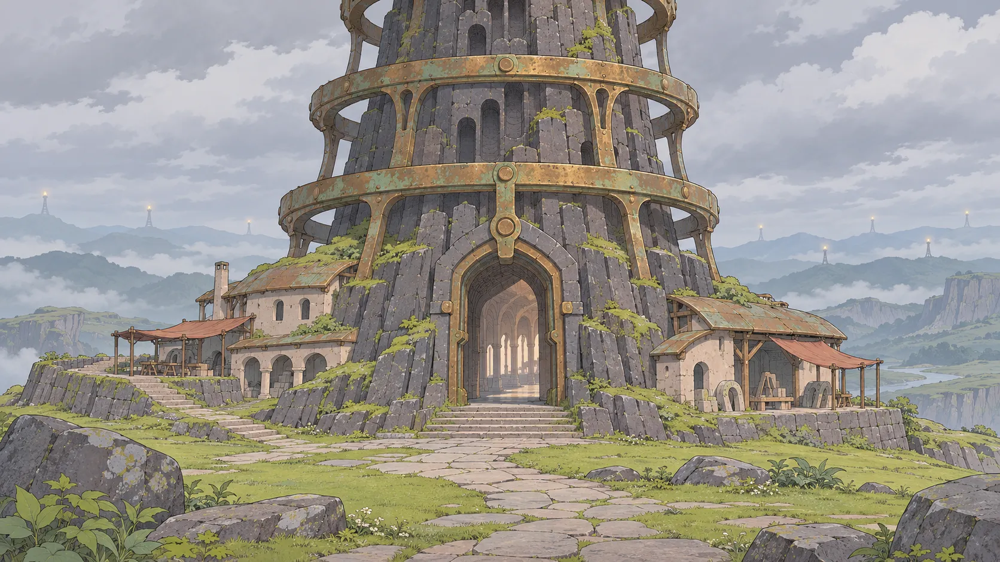 |

---

## 🕹️ Alur Cerita (Bab 0 – Bab 5 & Tiga Akhir)

1. **Bab 0 — Pos Nilasar & Cincin yang Menyengat:** Krisis pajak *Keping Tata*, penyitaan muatan oleh Kesa, tiga denyut bahaya di Menara Simpul ke-9, aktifnya Cincin Perunggu pada nadi Nara, dan pesan Sahdan via *Garis Surut*.
2. **Bab 1 — Blokade Garam, Rahasia Dusun Sela & Bara di Padang Salkara:** Pengakuan Nenek Ima atas darah Lulanai, pertemuan pertama dengan Maruani, pembukaan jalur bersama Orsuk, dan gencatan empat hari di Sidang Tujuh Panji.
3. **Bab 2 — Kebenaran Tepi Salkara & Arsip Terkunci Tseren:** Pembuktian rekaman batu pesisir Tepi Salkara dan temuan suntingan arsip *Perkara Pemutusan* di Pegunungan Silin.
4. **Bab 3 — Bandar Lada, Utang Kabar & Reuni Bahtari:** Pertemuan kembali dengan Tarun, jerat *Kontrak Sauh*, dan jalur laut menuju Lulan Tua.
5. **Bab 4A & 4B — Lulan Tua & Benteng Tata:** Penyatuan *Nada Penyegel* di Menara Simpul ke-1, konfrontasi Maruani, serta protokol darurat penghentian 7 Menara Simpul Redup bersama Taluk.
6. **Bab 5 — Menara Simpul ke-99 & Gerbang Surut:** Pertarungan tekad terakhir melawan Maruani dan tiga pilihan akhir nasib *Echoes*: **Terbuka**, **Terkendali**, atau **Terverifikasi** (*True / Balanced Ending*).

---

## 🛠️ Pengembangan & Pengujian Lokal

Proyek dibangun menggunakan JavaScript murni (*vanilla*), HTML5 Canvas/CSS3, dan Node.js tanpa ketergantungan eksternal saat runtime:

```sh
# Menjalankan server pengembangan lokal (http://127.0.0.1:4173)
npm run dev

# Menjalankan seluruh suite pengujian pixel + build + verifikasi bundle offline
npm test

# Membangun ulang paket HTML offline tunggal (Bab0-TopDown-Pixel/Jalur-Senyap-Complete-Pixel.html)
npm run build
```

---

## 📁 Berkas Dokumentasi & Kanon

- [`story bible/jalur_senyap_story_bible_rev1311.md`](story%20bible/jalur_senyap_story_bible_rev1311.md): **Story Bible Kanon Terbaru (Era 103 Post-Senyap)** — acuan lengkap sejarah, sistem *Perunggu Gaung*, Lima Bangsa, tokoh, Bab 0–5, tiga *ending*, nada dialog, aturan penamaan, dan glosarium.
- [`docs/PIXEL-HANDOFF.txt`](docs/PIXEL-HANDOFF.txt): Peta arsitektur kode pixel, invarian engine, dan daftar QA manual.
- [`docs/GAME-DESIGN-ART-DIRECTION.md`](docs/GAME-DESIGN-ART-DIRECTION.md): Panduan desain mekanik dan arahan seni.
