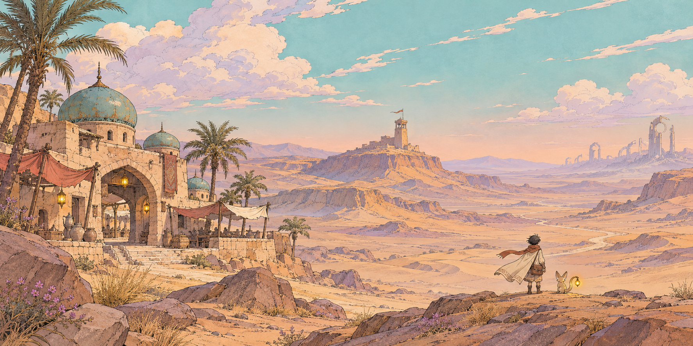

# Jalur Senyap



*Ilustrasi konsep Lembah Pasir di Tanah Sada.*

**Jalur Senyap** adalah game petualangan *third-person* tentang seorang kurir muda yang mengantar surat, janji, lagu, dan paket antarbangsa di dunia fantasi **Tanah Sada**. Tanpa combat, tanpa crafting, tanpa grinding. Yang ada hanyalah perjalanan, membaca kontur medan dan cuaca, serta kehangatan cerita di setiap pengantaran.

---

## 🎮 Coba Mainkan

Buka versi web interaktif langsung di browser: **[dhanesya98.github.io/jalursenyap](https://dhanesya98.github.io/jalursenyap/)**.  
Tidak perlu mengunduh aplikasi atau membuat akun. Cukup gunakan browser desktop modern dengan dukungan WebGL, keyboard, dan mouse (lihat [Kontrol](#kontrol)).

---

## 📜 Premis Cerita (Tahun ke-100 Telan)

Dahulu, seratus menara relay bernama **Simpul** mengalirkan **Gema** — fenomena resonansi langka yang menyimpan dan meneruskan getaran suara, ingatan, serta kabar antarbangsa di **Tanah Sada**. Jalur peradaban itu dikenal sebagai **Jalur Gema**.

Namun Gema tidak pernah menguji kebenaran pesan. Kabar dusta dan perang propaganda memecah bangsa-bangsa hingga memicu Kabar Tujuh Musim dan gelombang resonansi liar yang mengancam menghancurkan akal manusia. Pada **Tahun 0 (Tahun Telan / Hari Senyap / Malam Hening)**, para penyetel Lulanai mengambil keputusan tragis: mereka memutus jaringan Simpul secara serentak dengan menelan gelombang kejut ke tubuh mereka sendiri. Sisa gelombang dialirkan lewat Garis Surut ke Katup di Simpul Keseratus dan ditahan di balik **Bendungan**. Kurir legendaris **Sahdan** menjadi jangkar penstabil di Simpul Pertama dan menyatu dengan batu.

Seratus tahun telah berlalu (**Tahun ke-100 Telan**). Peradaban belajar hidup dalam keheningan, bertumpu pada kaki para kurir independen di Pos Singgah. Di sisi lain, **Dewan Tol** memonopoli jalur dengan *Ajaran Tata* dan menjual kabar tersaring lewat tujuh Simpul Terang. Tanpa disadari dunia, Bendungan seratus tahun itu kini mulai melemah dan tanda tekanan muncul di berbagai penjuru.

Kamu adalah **Nara** (17 tahun), kurir magang asal Dusun Sela yang melangkah agar *tidak ada lagi orang yang menunggu kabar sendirian*. Dalam **Bab 0 — Pos Batu Biru**, Maren meminjamkan tas kulit berinsulasi peninggalan Sahdan sebelum tugas pertama. Setelah roti hangat untuk Juma, Kerang Suara untuk Bu Lamat, dan laporan jujur atas tugas ketiga yang tertahan patroli Dewan ditambah lengkapnya tanda bahaya 009, Maren menyerahkan **Surat Penyalaan** — titipan rahasia empat generasi (*Sarai → Bahar → Ilun → Maren*) dengan seratus tanda penyetel. Maren membubuhkan **Cap Saksi Asharim** di atas bantalan tinta resonansi yang merekam suara nama Maren dan nama Nara. Segel surat hanya terbuka penuh bila memuat Cap Saksi dari setidaknya tiga bangsa.

Didampingi **Ruru**, penunjuk jalan berbulu yang peka pada jejak resonansi, tugas Nara bukan menjadi penakluk adidaya, melainkan menyambungkan kembali tali kepercayaan yang putus.

---

## 🧭 Inspirasi & Kompendium Lima Bangsa

Dunia **Tanah Sada** terinspirasi dari prinsip jalur dagang kuno (*Silk Road*) dan sistem pos estafet (*caravanserai*):

- **Kepercayaan sebagai mata uang:** Reputasi per bangsa (**Nama Baik**) menentukan akses ke pos, pengawalan karavan, dan izin melintas. Cap Saksi adalah wujud fisik kepercayaan tersebut.
- **Barang membawa jiwa:** Yang dibawa kurir bukan sekadar muatan fisik, melainkan roti hangat tanda rindu, Kerang Suara berisi rekaman lagu keluarga, hingga janji lisan antarpanji.
- **Lima Bangsa di Tanah Sada:**
  1. **Asharim (Lembah Pasir):** Penjaga persinggahan dan penguasa mata air gurun di bawah *Pakta Sumur Terbuka (Hukum Air)*. Sapaan: *"Teduh di jalanmu" / "Air di langkahmu"*. Terbelah antara Kubu Pos Tua (adat suaka netral) dan Kubu Pos Dagang (rekanan Dewan Tol).
  2. **Tseren (Pegunungan Kabut Lirih):** Penjaga catatan, pembuat kertas serat tahan air, dan notaris hukum di bawah *Kanon Aksara*. Sapaan: *"Tinta tenang" / "Kata terjaga"*. Terbelah antara Aliran Murni dan Aliran Rapi.
  3. **Cirusia (Padang Salkara):** Penjaga janji dan pengawal karavan sabana di bawah *Sumpah Api Tujuh Panji*. Sapaan: *"Angin searah" / "Janji sampai"*. Dipimpin sidang 7 klan dalam kebuntuan politik 3–3–1 (3 Panji Tua, 3 Panji Muda, 1 Panji Penengah/Suara Penentu).
  4. **Bahtari (Kepulauan Lada Biru):** Penjaga laut dan lagu di bawah *Hukum Sauh & Lagu*. Memonopoli lada biru (pengawet pangan utama). Sapaan: *"Pasang baik!" / "Layar penuh!"*. Terbelah antara oligarki Rumah Dagang dan serikat Rumah Layar.
  5. **Lulanai (Reruntuhan Hening):** Penyetel yang tersisa dan perancang jaringan Simpul di bawah *Ikatan Penyetel*. Sapaan: *"Hening menyertai"*. Terpencar dalam tiga faksi: Kaum Pantang, Kaum Terbuka, dan Kaum Sesal.

*Inspirasi mekanik & estetika:* **Death Stranding** (traversal, membaca rute, struktur persisten), **Moebius & Studio Ghibli** (garis tinta, palet pastel hangat), serta **Outer Wilds** (eksplorasi rasa ingin tahu tanpa kekerasan).

---

## 🕹️ Kontrol Permainan

| Tombol | Aksi |
| --- | --- |
| **W, A, S, D** / Panah | Berjalan / Berlari |
| **Shift** | Lari cepat (*Sprint*) |
| **Spasi** | Melompat; tahan saat jatuh untuk membuka **Jubah Layar** (*Glide*) |
| **Mouse** | Mengarahkan kamera; klik layar untuk mengunci kursor, `Esc` untuk melepas |
| **E** | Berbicara dengan NPC, memeriksa pos, memanjat tangga / tepian bertanda |
| **F** | Menyeberangi **Tali Lintas** pada tambatan tali berlentera |
| **L** | Memasang **Tangga Tali** permanen di penanda tebing |
| **Q** | Pindai kontur medan dan arah tujuan bersama Ruru (*cooldown* 12 detik) |
| **J** | Membuka **Buku Jalur** (Peta, Pengantaran, Catatan & Nama Baik, Lima Bangsa, Perlengkapan) |
| **H** / **Esc** | Panduan bantuan / Menu jeda (*Pause*) |

### Tips Perjalanan:
- Permukaan batu memberi cengkeraman lebih cepat daripada pasir hisap.
- Badai pasir gurun menguras daya apung Jubah Layar lebih cepat dan mengikis paket yang tidak terlindung.
- Musik latar (BGM) mengalun dinamis dan meredam menjadi *ambience* syahdu saat berbicara dengan NPC.

---

## 📖 Atlas & Buku Jurnal

- **Atlas Tanah Sada (`atlas.html`):** Katalog visual interaktif yang memuat model 3D karakter dan properti dengan pemeriksa sudut putar, galeri ilustrasi suasana, peta wilayah beresolusi tinggi, serta kompendium lengkap Lima Bangsa (fondasi Pra-Simpul, geopolitik Tujuh Panji, adat, dan tanda tekanan bendungan).
- **Buku Jalur (tekan `J` dalam game):** Jurnal lapangan kurir yang menyajikan peta elevasi kontur riil, status pengantaran, rumor & penemuan, reputasi Cap Saksi, serta kompendium bangsa.

---

## 🛠️ Pengembangan & Pengujian Lokal

Proyek ini dibangun menggunakan JavaScript murni (vanilla), Three.js lokal, HTML5/CSS3, dan Node.js untuk script build:

```sh
# Rebuild bundle data offline, link dialog, dan peta SVG
node tools/build.cjs

# Menjalankan 24 unit test inti + 7 pemeriksaan kanon
node tests/test.cjs
node tests/canon.cjs

# Menjalankan server lokal (opsional)
node tools/serve.cjs
# Buka http://127.0.0.1:4173
```

---

## 📁 Berkas Dokumentasi & Kanon

- [`docs/STORY-BIBLE.md`](docs/STORY-BIBLE.md): Dokumen acuan kanon lengkap 100 tahun Tanah Sada, Kunci Lore, Kompendium Lima Bangsa, dan percabangan tiga akhir cerita.
- [`docs/IMPLEMENTASI.md`](docs/IMPLEMENTASI.md): Catatan teknis implementasi vertical slice.
- `pos-batu-biru.html`: Halaman studi visual Pos Batu Biru.
